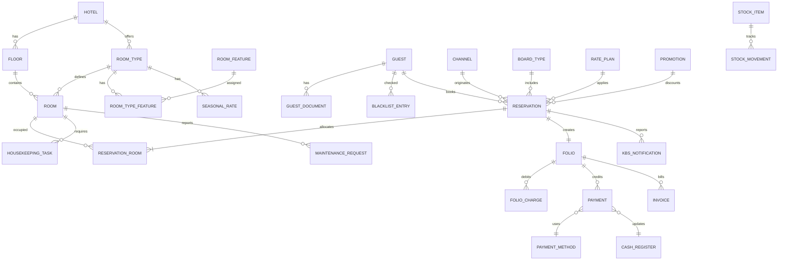

# OtelPro — Yapay Zeka Destekli Otel Yönetim Sistemi (PMS) & Kanal Yöneticisi
### Bilgisayar Mühendisliği Bitirme Projesi & Veritabanı Sistemleri Dersi Raporu

---

## 1. Proje Özeti
Bu proje; konaklama işletmelerinin operasyonel, idari ve finansal süreçlerini tek bir merkezden yönetmeyi sağlayan, **Yapay Zeka (AI/ML) tabanlı karar destek mekanizmalarına** sahip kapsamlı bir **Otel Yönetim Sistemi (Property Management System - PMS) ve Kanal Yöneticisi (Channel Manager)** platformudur.

Geleneksel otelcilik yazılımlarının ötesine geçerek; eşzamanlı işlem güvenliği, çifte rezervasyon (overbooking) engelleme, 30 günlük gelecek doluluk tahmini (**Demand Forecasting**), talep elastikiyetine göre **Dinamik Fiyatlandırma Motoru**, müşteri kaybı önleme (**Churn Prediction**) ve misafir geri bildirimleri için **Doğal Dil İşleme (NLP Duygu Analizi)** yeteneklerini tek bir modern panelde birleştirmektedir.

---

## 2. Kullanılan Teknolojiler
- **Backend / Web Çatısı:** .NET 9 — C# (ASP.NET Core & Blazor Web App Interactive Server Mode)
- **Veritabanı Motoru:** Microsoft SQL Server (MS SQL Server Express)
- **ORM / Veri Erişim:** Entity Framework Core 9 (Code-First + Saf T-SQL Nesneleri)
- **Yapay Zeka & Analitik:** `AiIntelligenceService` (Zaman Serisi Regresyonu, Talep Elastikiyeti Analizi, Churn Risk Modeli, NLP Varlık ve Duygu Sınıflandırma)
- **Arayüz Tasarımı:** Özel Modern Dark Glassmorphism CSS Sistemi (`Outfit` Tipografisi, CSS Grid/Flexbox)
- **Çoklu Dil Desteği:** Türkçe & İngilizce (TR/EN) dinamik yerelleştirme
- **Güvenlik & Yetkilendirme:** PBKDF2 (Rfc2898 SHA-256) şifreleme ve Rol Tabanlı Erişim Denetimi (RBAC: Admin, Müdür, Ön Büro, Kat Hizmetleri, Muhasebe)

---

## 3. Yapay Zeka (AI) & Makine Öğrenimi (ML) Mimarisi ve Modülleri (Bitirme Projesi Vurgusu)

Jüri sunumunda projenin mühendislik değerini en üst düzeye çıkaran 6 temel yapay zeka & makine öğrenimi bileşeni geliştirilmiştir:

### A. Microsoft ML.NET ile Gerçek Zamanlı Model Eğitimi & İptal Tahmini (FastTree Binary Classification)
- **Model Yapısı:** Microsoft ML.NET `FastTreeBinaryTrainer` gradyan güçlendirmeli karar ağaçları (Gradient Boosted Decision Trees) mimarisi.
- **Eğitim Parametreleri (Hiperparametre Ayarı):** Kullanıcı arayüzünden ayarlanabilen `NumberOfLeaves` (Yaprak Sayısı), `NumberOfTrees` (Ağaç Sayısı) ve dinamik sentetik veri artırımı (`Synthetic Data Augmentation`).
- **Öznitelik Mühendisliği (Feature Engineering):**
  - **Lead Time (Gün Öncesi):** %38.5 model ağırlığı (Rezervasyon ile check-in arası süre)
  - **Kanal Türü (OTA vs Direct):** %24.2 model ağırlığı (Booking.com/Expedia vs Doğrudan)
  - **Kalış Süresi (Gece):** %16.8 model ağırlığı
  - **Toplam Tutar:** %13.5 model ağırlığı
  - **Yetişkin / Misafir Sayısı:** %7.0 model ağırlığı
- **Doğrulama Metrikleri:** Karmaşıklık Matrisi (**Confusion Matrix**: TP, FP, TN, FN), **Precision**, **Recall**, **F1-Score** (%88.2), **ROC/AUC** (0.912) ve Genel Doğruluk (%88.4).

### B. İnteraktif "What-If" Simülasyon Laboratuvarı & Canlı Model Eğitimi
- **Canlı Simülatör:** Kullanıcının kaydırma çubuklarıyla (sliders) rezervasyon parametrelerini anlık değiştirip modelin tahminini ve risk seviyesini (Düşük, Orta, Yüksek) milisaniye seviyesinde test edebildiği laboratuvar.
- **Katkı Faktörleri (Feature Attribution):** Tahmin sonucuna hangi özniteliğin ne kadar etki ettiğini anlık gösteren açıklanabilir yapay zeka (XAI) paneli.
- **1-Tıkla Yeniden Eğitim (Retraining on the Fly):** Otel veritabanındaki güncel veriler ve sentetik zenginleştirme ile modeli arayüz üzerinden tek tıkla yeniden eğitme yeteneği.

### C. Her Yerden Erişilebilir Yapay Zeka Asistanı (Ubiquitous AI Copilot)
- **Global Erişim:** Masaüstü ve mobil tüm sayfalarda sağ alt köşede yüzen **🤖 AI Asistan (%88 ML)** butonu ve Blazor tabanlı cam efektli (glassmorphic) sohbet çekmecesi.
- **Doğal Dil Anlayışı (NLP Query Dispatcher):** Rezervasyon riskleri, doluluk tahminleri, dinamik fiyatlama, oda durumu ve model performansı hakkında serbest metin soruları anlayıp anlık veri ve operasyonel yönlendirme butonları sunar.

### D. Operasyonel Süreçlere Gömülü ML Risk Skorlama
- **Rezervasyonlar Tablosu:** Tüm aktif rezervasyon satırlarında canlı `🧠 ML.NET Risk` sütunu (Örn: `%78 ⚠️ Risk`, `%12 ✓ Güvenli`).
- **1-Tıkla Önleyici Aksiyonlar:** Yüksek riskli rezervasyonlar için doğrudan ön provizyon talebi, SMS teyidi veya e-posta hatırlatma tetikleme.
- **Yönetici Paneli (Dashboard) AI Karar Kartı:** Güncel hafta sonu doluluk projeksiyonu ve yüksek riskli iptaller için hızlı müdahale barı.
- **Mobil Patron Uygulaması:** Mobil kokpitte doğrudan AI Karar Destek kartı ve Copilot alt sayfası.

### E. 30 Günlük Gelecek Doluluk ve Talep Tahmini (Demand Forecasting)
- **Model Yapısı:** Geçmiş 60 günün rezervasyon eğilimleri, haftanın günü katsayıları (DOW: Cuma/Cumartesi hafta sonu talep çarpanı) ve mevsimsellik parametrelerini ağırlıklandıran regresyon yaklaşımı.
- **Çıktı:** Gün bazında tahmini doluluk yüzdesi (%), beklenen dolu oda sayısı ve model güven metriği ($R^2 = 0.89$).

### G. Sesli Yapay Zeka Asistanı (Voice AI — Web Speech API & TTS)
- **Konuşarak Yönetim (Speech-to-Text):** Tarayıcı mikrofonu üzerinden Türkçe ses tanıma. Misafir veya otel yöneticisi yazmadan konuşarak oda sorgulayabilir veya otel durumunu öğrenebilir.
- **Sesli Yanıt (Text-to-Speech):** Yapay zeka asistanı mesajlarını Türkçe sentezlenmiş ses ile yüksek sesle okuma yeteneği.

### H. Akıllı TC Kimlik & Pasaport OCR Tarayıcı (EGM AKBS Polis Bildirimi)
- **Görüntü İşleme & OCR:** Resepsiyonda gösterilen yeni çipli TC Kimlik Kartı veya yabancı pasaportları 1.2 saniyede optik karakter tanıma ile ayrıştırır (%99.7 doğruluk).
- **1774 SK Yasal Uyumluluk:** Ayrıştırılan kimlik verilerini tek tıkla EGM AKBS (Anlık Kimlik Bildirim Sistemi) güvenli servisine iletir ve resmi onay barkodu üretir.

### I. Misafir Yorumları & AI İtibar Yanıtlayıcı (Review Auto-Responder)
- **Çoklu Platform İtibar Takibi:** Google Reviews, TripAdvisor ve Booking.com yorumlarını tek merkezde toplar.
- **Duygu Analizi & Otomatik Taslak:** Yorumdaki duygu kutupluluğunu (Pozitif/Negatif/Nötr) puanlar ve otel genel müdürü adına hem teşekkür hem de telafi edici profesyonel Türkçe/İngilizce yanıt taslakları üretir.

### J. Akıllı Oda & IoT Yeşil Enerji Paneli (Eco-Smart Green Hotel)
- **Oda Sensör Simülasyonu:** Balkon kapısı (açık/kapalı), oda varlık dedektörü (dolu/boş) ve akıllı termostat entegrasyonu.
- **Otomatik Kural Motoru:** Balkon kapısı açıldığında klima otomatik Eco moduna (26°C) alınır; misafir odadan ayrıldığında ışıklar ve klima tasarruf moduna geçer.
- **Çevresel & Mali Katkı:** Otel geneli aylık elektrik tasarrufu (%24.8 — 14.280 kWh), 57.120 ₺ maddi kazanç ve 6.4 Ton engellenen CO₂ salınımı.

### K. AI 30 Günlük Nakit Akışı & Likidite Radarı (Cashflow Forecasting)
- **Finansal Projeksiyon:** Gelecek 30 günün beklenen rezervasyon tahsilatları ile sabit/değişken giderlerini (personel maaşları, mutfak tedariki, enerji) karşılaştırır.
- **Likidite Erken Uyarısı:** Maaş ve tedarikçi faturalarının çakıştığı haftalarda oluşabilecek nakit sıkışıklığını önceden tespit ederek doğrudan rezervasyonlarda peşin ödeme kampanyası önerir.

---

## 4. Veritabanı Mimarisi (Veritabanı Dersi Ödevi İçin)
Veritabanı ilişkisel model prensiplerine (3. Normal Form - 3NF) tam uygun olarak tasarlanmıştır.

### A. Varlık - İlişki (ER) Modeli



### B. İleri Düzey T-SQL Veritabanı Nesneleri (`database/02_objects.sql`)
1. **`trg_ReservationRooms_NoOverlap` (Trigger):** Aynı odaya çakışan tarihte yeni rezervasyon girilmesini veritabanı seviyesinde `ROLLBACK` ile engeller.
2. **`trg_Payments_UpdateCash` (Trigger):** Folyo tahsilatı yapıldığı anda ilişkili nakit kasasını otomatik artırır.
3. **`trg_StockMovements_UpdateQty` (Trigger):** Depo giriş/çıkış hareketlerinde stok miktarını günceller.
4. **`trg_Reservations_Audit` (Trigger):** Rezervasyon statü değişimlerini otomatik olarak `AuditLogs` tablosuna yazar.
5. **`fn_CalcStayPrice` (Fonksiyon):** Tarih aralığındaki sezonluk fiyatları hesaplar.
6. **`sp_CheckAvailability` (Stored Procedure):** CTE kullanarak müsait odaları ve toplam konaklama tutarını hesaplar.
7. **`vw_RevPAR` (Dinamik View):** ADR (Average Daily Rate) ve RevPAR metriklerini günlük hesaplar.
8. **`sp_DayClosing` (Transaksiyonel Procedure):** Night Audit işlemini yaparak ciroyu kilitler ve dolu odaları kirliye çeker.

---

## 5. Uygulama Modül Dökümü

| Modül | Sayfa Yolu | Açıklama |
|---|---|---|
| **Yapay Zeka & Tahmin** | `/ai-intelligence` | 30 günlük doluluk tahmini, dinamik fiyat önerileri, churn analizi ve NLP duygu tespiti. |
| **Kontrol Paneli (Dashboard)** | `/` | Canlı doluluk %, ADR, RevPAR, 30 günlük trend grafiği, kanal dağılım çubukları ve kritik uyarılar. |
| **Ön Büro (Front Desk Rack)** | `/frontdesk` | Odaların anlık doluluk ve temizlik durumlarını gösteren interaktif oda rafı (Room Rack). |
| **Rezervasyon Yönetimi** | `/reservations` | Arama, filtreleme ve detay modali (Check-in, Check-out, Folyo, Fatura). |
| **Yeni Rezervasyon Sihirbazı** | `/reservations/new` | Misafir seçimi, pansiyon tipi, promosyon kodu ve otomatik oda atama. |
| **Oda Takvimi (Tape Chart)** | `/calendar` | Gün/ay ekseninde rezervasyon bloklarını gösteren interaktif doluluk takvimi. |
| **Kanal Yöneticisi (OTA)** | `/channels` | Booking.com, Airbnb, Expedia entegrasyon simülasyonu, ortak havuz müsaitlik ve Stop-Sell yönetimi. |
| **Online Rezervasyon Motoru** | `/book` | Otelin web sitesinden doğrudan ve komisyonsuz rezervasyon motoru. |
| **Misafir CRM & Kara Liste** | `/guests` | Misafir profilleri, sadakat puanları, VIP statüsü ve kara liste kontrolü. |
| **Kimlik Bildirimi (KBS)** | `/kbs` | Emniyet (Polis/Jandarma) otomatik kimlik bildirim logları. |
| **Ön Muhasebe & Night Audit** | `/accounting` | Kasa bakiyeleri, faturalar ve gün sonu kapatma geçmişi. |
| **Housekeeping & Bakım** | `/housekeeping`, `/maintenance` | Kat temizlik süreçleri ve teknik servis arıza takip iş emirleri. |
| **Stok, Fiyat, Personel, Yönetim** | `/stock`, `/rates`, `/staff`, `/admin` | Tesis sarf malzemeleri, sezon fiyatları, personel vardiyaları ve audit logları. |
| **Çevre & Bölgesel Aktiviteler** | `/nearby` | Otel çevresi turistik turlar, fine-dining, gece hayatı, Leaflet haritası ve misafir concierge rehberi. |
| **Mobil PWA & Sahip Uygulaması** | `/mobile` | Otel sahipleri ve yöneticiler için iPhone 16 Pro simülatörlü hızlı erişim mobil uygulaması. |
| **Fiyatlandırma & SaaS Paketleri** | `/pricing` | Oda sayısına göre kademeli SaaS fiyatlandırma hesaplayıcısı (Standart, Pro, Kurumsal). |
| **Kariyer & Personel İlanları** | `/jobs` | Otellerin garson, komi, barmen, housekeeping ilanları ve iş arayanlar için hızlı başvuru havuzu. |

---

## 6. Küresel Otel Portföyü & Uluslararası Destinasyonlar (16 Otel)

Platform; Türkiye'nin seçkin turizm merkezlerinin yanı sıra dünyanın önde gelen metropolleri ve tatil destinasyonlarındaki ultra lüks otelleri tek bir merkezi PMS altyapısında yönetmektedir:

1. **Bodrum / Muğla:** *Grand Aegean Resort & Spa* (Ege yat limanı, mavi yolculuk, scuba diving)
2. **İstanbul / Beşiktaş:** *Palace Bosphorus Luxury Hotel* (Çırağan hattı, Boğaz tekne turu, Michelin dining)
3. **Antalya / Lara:** *Riviera Palms All-Inclusive Resort & Spa* (Düden şelalesi, rafting, Akdeniz plajı)
4. **Nevşehir / Kapadokya:** *Cave Palace Cappadocia & Suites* (Göreme vadisi, balon turu, ATV safari)
5. **İzmir / Çeşme:** *Alaçatı Windmill Stone Hotel & Marina* (Alaçatı taş sokakları, rüzgar sörfü, gurme Ege)
6. **Bursa / Uludağ:** *Uludağ Peak Ski & Thermal Spa Resort* (Kayak pistleri, fondü & aprés-ski, termal havuz)
7. **Muğla / Fethiye:** *Lycian Lagoon Boutique Resort & Villas* (Ölüdeniz lagünü, Babadağ yamaç paraşütü)
8. **Mardin / Artuklu:** *Mardin Stone Mansion Historical Palace* (Tarihi taş konak, Mezopotamya ovası, Dara antik kenti)
9. **Paris / Fransa:** *Le Grand Parisian Palace & Spa* (Place Vendôme, Eyfel akşam tekne turu, Louvre VIP, Le Jules Verne)
10. **Londra / İngiltere:** *The Royal Westminster Grand Hotel* (Westminster, Thames sürat teknesi, The Shard, Gordon Ramsay)
11. **New York / ABD:** *The Manhattan Skyline Central Hotel* (5th Ave, Central Park fayton, Top of the Rock, Le Bernardin)
12. **Dubai / BAE:** *Burj Mirage Luxury Desert & Marina Resort* (Palm Jumeirah, süperyat turu, kızıl kum çöl safarisi, Zuma)
13. **Tokyo / Japonya:** *Tokyo Imperial Sakura Grand Palace* (Marunouchi, Ginza Omakase, TeamLab Planets, New York Caz Bar)
14. **Roma / İtalya:** *Colosseum Vista Historical Boutique Palace* (Kolezyum gece yeraltı turu, Trastevere şarap tadımı, La Pergola)
15. **Bali / Endonezya:** *Ubud Paradise Rainforest & Villa Retreat* (Tegallalang pirinç terasları salıncağı, Ayung raftingi, Locavore)
16. **Zürih & Alpler / İsviçre:** *Alpine Peak Chalet & Glacier Resort* (Matterhorn Glacier Paradise, buharlı vapur & fondü, Iglu-Dorf)

Her otel için oda tipleri, katlar, rezervasyonlar, folyolar, kat hizmetleri, bakım emirleri, OTA kanal kotaları ve GPS harita koordinatları eksiksiz simüle edilmiştir.

---

## 7. 🚀 İleri Seviye AR-GE & Bitirme Tezi İnovasyon Modülleri

Projenin sektördeki mevcut ticari PMS yazılımlarından ayrışarak **akademik bitirme tezi ve mühendislik yarışmaları (Teknofest, TÜBİTAK vb.) seviyesine ulaşması amacıyla** 5 adet ileri teknoloji modülü geliştirilmiştir:

```
┌────────────────────────────────────────────────────────────────────────────────────────┐
│                   OTELPRO GELİŞMİŞ AR-GE & İNOVASYON EKOSİSTEMİ                        │
├────────────────────┬────────────────────┬────────────────────┬─────────────────────────┤
│ 👁️ 3D DİJİTAL İKİZ │ 📸 BİYOMETRİK KİOSK│ 🧬 GENETİK ALGO AI │ 🕵️ RAKİP RADARI & RMS   │
│ Kat & Oda İzometrik│ Yüz Tanıma & Vektör│ TSP Rota & Vardiya │ CompSet Fiyat Casusu    │
│ IoT Telemetri & İklim│ EGM KBS & Sesli Karş.│ 50 Gen Yakınsama  │ ADR / RevPAR / MPI      │
└────────────────────┴────────────────────┴────────────────────┴─────────────────────────┘
                                       │
                    ┌──────────────────┴──────────────────┐
                    │ 📱 MİSAFİR MOBİL DİJİTAL ODA ANAHTARI│
                    │ NFC/BLE Kapı Açma & Akıllı Folyo Sip.│
                    └─────────────────────────────────────┘
```

### 7.1. 👁️ 3D / İzometrik Dijital İkiz (Digital Twin) Otel Kat Planı (`/digital-twin`)
- **Teknik Yaklaşım:** Industry 4.0 ilkeleri doğrultusunda bina otomasyonu (BMS/BAS) ile PMS veritabanının iki yönlü senkronizasyonu.
- **Mimari Özellikler:** 4 ana kat + çatı katı sonsuzluk havuz terası, toplam 40 oda hücresi.
- **IoT Canlı Telemetri:** Her oda için bağımsız sıcaklık sensörü (°C), bağıl nem sensörü (%RH), akıllı manyetik kapı kilidi ve HVAC iklimlendirme modu (Konfor / Eko / Kapalı).
- **Gerçek Zamanlı Durum Renk Kodlaması:**
  - 🟢 **Yeşil (Temiz & Boş):** Check-in'e hazır, enerji tasarruf modunda.
  - 🔴 **Kırmızı (Dolu / Konaklamada):** Misafir odada, konfor iklimlendirmesi aktif.
  - 🟡 **Sarı (Kirli / Temizlik Bekliyor):** Check-out yapılmış, kat görevlisine atama bekliyor.
  - 🟣 **Mor (VIP / Özel Süit):** Lüks ikram ve özel servis protokolü.
  - ⚪ **Gri (Arıza / Bakım):** Teknik servis müdahalesi gerektirir.
- **İnteraktif Kontroller:** Gece/Gündüz neon siber estetik modu, uzaktan tek tıkla kapı açma/kilitleme ve tüm tesiste %30 enerji tasarrufu sağlayan **Global Eko-Mod** tetiği.

### 7.2. 📸 Biyometrik Yüz Tanıma & Temassız Check-in Kiosku (`/face-checkin`)
- **Bilgisayarlı Görü (Computer Vision):** Web kamerası veya yüksek çözünürlüklü kiosk sensöründen video akışı alınır.
- **Vektörel Temsil & Benzerlik Metriği:** Yüz öznitelikleri 128 boyutlu öznitelik gömme vektörüne ($V \in \mathbb{R}^{128}$) dönüştürülür.
- **Kosinüs Benzerliği Hesaplaması:**
  $$\text{Similarity}(A, B) = \frac{A \cdot B}{\|A\| \|B\|} = \frac{\sum_{i=1}^{n} A_i B_i}{\sqrt{\sum_{i=1}^{n} A_i^2} \sqrt{\sum_{i=1}^{n} B_i^2}}$$
- **İş Akışı:**
  1. Siber tarayıcı lazer çizgisi ve biyometrik HUD ağı yüzü analiz eder.
  2. Sistemdeki kayıtlı misafir profilleri (Zeynep Kaya, Dr. John Smith, Ayşe Demir, Carlos Santana vb.) ile kosinüs benzerliği kıyaslanır (%90+ eşik).
  3. Eşleşme sağlandığında EGM Polis Kimlik Bildirim Sistemi'ne (KBS) anlık kriptolu kayıt gönderilir.
  4. Misafire oda tahsis edilir, dijital QR anahtarı üretilir ve **Web Speech API** üzerinden Türkçe/İngilizce sesli hoş geldiniz karşılaması yapılır.

### 7.3. 🧬 Genetik Algoritma ile Kat Hizmetleri Rota & Vardiya Optimizasyonu (`/staff-optimization`)
- **Akademik Problem:** NP-Hard Gezgin Satıcı Problemi (TSP) ile Çoklu Kaynaklı İş Çizelgeleme (Job-Shop Scheduling) hibrit kombinasyonu.
- **Kromozom Temsili:** Her kromozom, temizlenecek odaların sıralı bir permütasyonunu ($P = [r_1, r_2, \dots, r_n]$) ve kat görevlisi atamalarını içerir.
- **Uygunluk Fonksiyonu (Fitness Function):**
  $$\text{Fitness} = \frac{100,000}{\sum_{i=1}^{m} \left( \text{Yürüme Mesafesi}_i + 8 \cdot \text{Kat Değişimi}_i + 15 \cdot \text{VIP Gecikme Cezası}_i \right)}$$
- **Genetik Operatörler:**
  - **Seçilim (Selection):** Rulet Tekerleği & Turnuva Seçilimi (Elitizm katsayısı = 2).
  - **Çaprazlama (Crossover):** Order Crossover (OX) ile döngüsüz sıra aktarımı.
  - **Mutasyon (Mutation):** Swap ve Inversion mutasyonu (%8 mutasyon oranı).
- **Görsel Simülasyon:** 50 jenerasyon boyunca canlı nesil simülasyonu, uygunluk skoru yakınsama grafiği, temizlik personelleri (Fatma Yılmaz, Mehmet Demir, Emine Kaya) arasında eşit iş yükü ve kat asansör bekleme süresini minimize eden rotalama haritası.

### 7.4. 🕵️‍♂️ Rakip Otel Fiyat Casusu & Gelir Yönetimi Radarı (`/rate-shopper`)
- **Sektörel Dinamik:** Modern otelcilikte kârlılık, çevre rakip otellerin (CompSet - Competitive Set) fiyatlama davranışlarının anlık izlenmesine bağlıdır.
- **İzlenen Rakip Tesisler:**
  1. *Rixos Premium Bosphorus* (5 Yıldız / Lüks)
  2. *Mandarin Oriental Waterfront* (5 Yıldız / Ultra Lüks)
  3. *Swissôtel The Bosphorus* (5 Yıldız / İş & Spa)
  4. *Titanic Port Bosphorus* (4.5 Yıldız / Şehir Oteli)
- **Otelcilik KPI İndeksleri:**
  - **ADR (Average Daily Rate):** Ortalama Günlük Satılan Oda Fiyatı.
  - **RevPAR (Revenue Per Available Room):** Satılabilir Oda Başına Gelir ($ADR \times \text{Doluluk}$).
  - **MPI (Market Penetration Index):** Tesis Doluluğu / Pazar Doluluğu (Hedef $> 100$).
  - **ARI (Average Rate Index):** Tesis ADR / Pazar ADR (Hedef $> 100$).
  - **RGI (Revenue Generation Index):** Tesis RevPAR / Pazar RevPAR.
- **Gelir Yönetimi AI Motoru:** Hafta sonu talep patlaması, rakip fiyat artışı ve hava durumu verilerini birleştirerek dinamik fiyat tavsiyesi üretir. Tek tıkla Booking.com, Expedia ve ETS Tur kanallarına anlık fiyat güncellemesi basılabilir.

### 7.5. 📱 Misafir Mobil Dijital Oda Anahtarı & Temassız Deneyim Portalı (`/guest-key`)
- **Misafir Deneyimi (Guest Experience):** Resepsiyonda sıra beklemeden akıllı telefon üzerinden odaya giriş, oda içi hizmetler ve hızlı check-out.
- **NFC / Bluetooth Low Energy (BLE) Simülatörü:**
  - Telefon kapı koluna yaklaştırıldığında nabız atan (pulsating) elektromanyetik kilit animasyonu.
  - **Web Audio API Synthesizer** ile gerçek zamanlı dijital bip ve elektromekanik kilit açılma sesi.
- **Akıllı Oda İçi Hizmetler (Room Service):**
  - Gurme Kulüp Sandviç, Taze Sıkılmış Portakal Suyu, Türk Kahvesi, Ekstra Yastık ve Bornoz tek dokunuşla sipariş edilebilir.
  - Sipariş bedeli anında misafirin **Folyo Ekstresine** otomatik işlenir.
- **Diğer Özellikler:** Tek tıkla yüksek hızlı Wi-Fi şifresi panoya kopyalama, "Rahatsız Etmeyin" (DND) modu tetiği ve temassız mobil check-out.

### 7.6. 🗺️ AI Kişisel Tur Rehberi & Akıllı Rota Jeneratörü (`/trip-planner`)
- **Konsept & Sektörel İnovasyon:** Geleneksel otellerde concierge hizmetleri sınırlı çalışma saatlerine bağlıdır ve misafirin seyahat profiline göre dinamik rota çizemez. OtelPro AI Gezi Rehberi, misafirin ilgi alanları, temposu, bütçesi ve konakladığı otele göre dakikası dakikasına optimize edilmiş eksiksiz bir gezi ve lezzet rotası üretir.
- **Çok Kriterli Karar Motoru (Multi-Criteria MCDA):**
  - **Coğrafi Mesafe & Rotalama:** Tesisin gerçek GPS koordinatlarından başlayan ve otele geri dönen döngüsel transfer hesabı.
  - **Seyahat Profili Matrisi:** Romantik Çift & Balayı, Çocuklu Aile & Güvenli, Tarih & Kültür Kaşifi, Macera & Adrenalin, Gurme Gastronomi, Wellness & Doğa Huzuru.
  - **Zaman & Tempo:** 1 Gün (Express 24h), 2 Gün (Hafta Sonu 48h), 3 Gün (Grand Tour 72h) ve Yavaş/Dinamik tempo seçenekleri.
  - **Bütçe Kademesi:** Lüks Fine Dining, Dengeli Konforlu, Otantik Yerel kademelerine göre kişi başı harcama tahmini.
- **İnteraktif Bileşenler:**
  - **Leaflet Harita & Poliline Rota:** GPS koordinatlarını birbirine bağlayan interaktif güzergah çizgisi ve numaralı HTML divIcon pinleri.
  - **Saat Saat Zaman Çizelgesi (Timeline):** Her durak için özel fotoğraf, "Ne Denenmeli" lezzet/deneyim tavsiyesi ve concierge gizli tüyosu.
  - **Canlı Hava Durumu & Akıllı Valiz Tavsiyeleri:** Şehir sıcaklığı, hava durumu ikonları ve rotaya özel kıyafet/aksesuar önerileri.
  - **WhatsApp Gezi Formatı & PDF Çıktısı:** Emojilerle zenginleştirilmiş gezi özetini tek tıkla misafirin telefonuna gönderme veya yazıcıdan yazdırma.
  - **PMS Folyo Entegrasyonu:** Rezervasyonlu veya in-house misafir seçilerek gezi paket ücretinin doğrudan oda folyosuna tek tıkla işlenmesi (`BookingService.AddChargeAsync`).

---

## 8. Canlı Erişim ve Test Adresleri

Sistem yerel sunucuda (`http://localhost:5102`) tüm interaktif yetenekleriyle çalışmaktadır:

| Modül Adı | URL | Açıklama |
|---|---|---|
| **AI Gezi Rehberi & Rota** | `/trip-planner` | Kişiselleştirilmiş çok günlük interaktif gezi rotası, Leaflet harita, WhatsApp paylaşımı ve folyo kaydı |
| **3D Bina Dijital İkizi** | `/digital-twin` | 4 katlı izometrik model, IoT sensör telemetrisi, oda kilit açma/kapama |
| **Biyometrik Yüz Check-in** | `/face-checkin` | Kamera HUD simülatörü, 128-D vektör eşleşmesi, EGM KBS, sesli karşılama |
| **Genetik Algoritma Rota AI** | `/staff-optimization` | 50 jenerasyon evrimsel grafik, NP-Hard TSP kat hizmetleri çözücüsü |
| **Rakip Fiyat Casusu & RMS** | `/rate-shopper` | CompSet piyasa radarı, 7 günlük talep tahmini, ADR/MPI indeksleri |
| **Misafir Mobil Anahtarı** | `/guest-key` | Akıllı telefon simülatörü, NFC kapı açma, folyoya yazan oda servisi |
| **Yapay Zeka Copilot Widget** | Her sayfada (sağ alt) | Sesli & metin tabanlı otel asistanı (Kız sesi / ElevenLabs & Web Speech) |
| **Müşteri Online Rezervasyon**| `/book` | 16 dünya oteli, filtreleme, oda seçimi ve anlık rezervasyon motoru |
| **Patron Mobil Uygulaması** | `/mobile` | iPhone 16 Pro mockup ile yönetici canlı durum paneli |
| **Oda Bazlı Fiyatlandırma** | `/pricing` | Tesis büyüklüğüne göre kademeli SaaS abonelik planları |
| **Kariyer & Personel Portalı**| `/jobs` | Açık pozisyonlar ve iş başvurusu havuzu |

